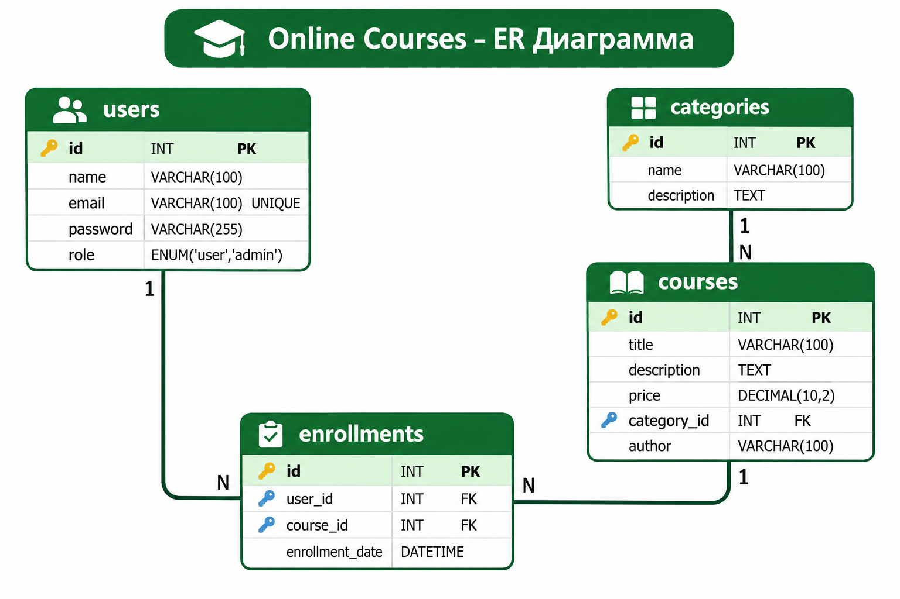

Онлайн курстарды басқару платформасы 

## Жоба туралы
Online Courses — онлайн курстарды басқаруға арналған веб-платформа. Пайдаланушылар тіркеліп, жүйеге кіріп, курстарды көріп, іздеп және оларға жазыла алады.

## Негізгі мүмкіндіктері
- Пайдаланушыны тіркеу және жүйеге кіру
- Курстар тізімін көру
- Курстарды іздеу
- Санаттар бойынша сүзгілеу
- Курстарға жазылу
- Әкімші мүмкіндіктері

## Қолданылған технологиялар
- HTML
- CSS
- JavaScript
- PHP
- MySQL
- PDO
- XAMPP

## Деректер қорының құрылымы
Жобада 4 негізгі кесте қолданылады:
1. users — пайдаланушылар
2. categories — курс санаттары
3. courses — курстар
4. enrollments — курстарға жазылу деректері

## ER-диаграмма

## Қауіпсіздік шаралары
- Құпиясөздерді password_hash() арқылы хэштеу
- password_verify() арқылы құпиясөзді тексеру
- PDO Prepared Statements қолдану
- Енгізілген деректерді тексеру
- Сессия арқылы авторизациялау
- Рөлдер бойынша қолжетімділікті шектеу

## Жобаның мақсаты
Онлайн курстарды ыңғайлы басқару, пайдаланушыларға білім алу мүмкіндігін ұсыну және курстар туралы ақпаратты бір жүйеде сақтау.